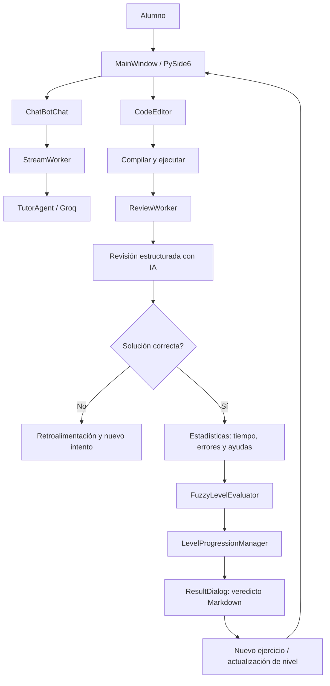

# TutorIA — Sistema Tutor Inteligente de Python

**TutorIA** es una aplicación de escritorio desarrollada en Python que ayuda a estudiantes a practicar programación mediante ejercicios adaptativos, asistencia conversacional y evaluación automatizada de soluciones. Combina una interfaz construida con **PySide6**, un tutor basado en modelos de lenguaje (**LangChain + Groq**) y un sistema de **lógica difusa Mamdani** implementado con **scikit-fuzzy** para valorar el desempeño y administrar la progresión académica.

> **Estado:** proyecto académico en desarrollo. Este documento describe la versión funcional diseñada durante el desarrollo del proyecto, incluyendo los módulos de progresión y lógica difusa añadidos posteriormente a la versión inicial del repositorio. Algunos nombres o rutas pueden variar si aún no se han incorporado todos los cambios a tu rama local.

## Índice

1. [Objetivo](#objetivo)
2. [Características](#características)
3. [Niveles de aprendizaje](#niveles-de-aprendizaje)
4. [Tecnologías](#tecnologías)
5. [Arquitectura](#arquitectura)
6. [Estructura del proyecto](#estructura-del-proyecto)
7. [Requisitos previos](#requisitos-previos)
8. [Instalación y configuración](#instalación-y-configuración)
9. [Ejecución](#ejecución)
10. [Uso de la aplicación](#uso-de-la-aplicación)
11. [Evaluación del código](#evaluación-del-código)
12. [Sistema de lógica difusa](#sistema-de-lógica-difusa)
13. [Progresión de niveles](#progresión-de-niveles)
14. [Componentes principales](#componentes-principales)
15. [Pruebas y validación](#pruebas-y-validación)
16. [Limitaciones y trabajo futuro](#limitaciones-y-trabajo-futuro)
17. [Seguridad](#seguridad)
18. [Autor y licencia](#autor-y-licencia)

## Objetivo

Diseñar un tutor inteligente que permita aprender Python de manera progresiva y personalizada. La aplicación busca que el alumno **resuelva los problemas por sí mismo**, reciba orientación cuando la solicite y avance a un nivel superior cuando su desempeño sea suficiente.

Objetivos específicos:

- Proponer ejercicios adecuados al nivel actual del alumno.
- Proporcionar ayudas breves sin revelar prematuramente las soluciones.
- Comprobar la sintaxis, ejecutar código y mostrar su salida.
- Revisar las soluciones con un agente de IA y entregar retroalimentación.
- Medir el tiempo invertido, los errores cometidos y las ayudas solicitadas.
- Transformar esas métricas en una puntuación mediante lógica difusa.
- Decidir de forma controlada cuándo ascender, mantenerse o descender de nivel.

## Características

- **Interfaz gráfica:** editor de código, descripción del ejercicio, consola de salida, botón de compilación, botón Run y chat Help.
- **Tutor conversacional:** ejercicios generados por IA con instrucciones diferentes según el nivel.
- **Ayuda contextual:** el alumno puede plantear preguntas relacionadas con el ejercicio; la respuesta se presenta progresivamente mediante streaming.
- **Revisión automática:** `ReviewWorker` solicita al modelo una evaluación estructurada de la solución después de una ejecución sin excepciones.
- **Estadísticas de aprendizaje:** cronómetro, contador de errores y contador de preguntas realizadas al agente.
- **Inferencia difusa Mamdani:** 27 reglas sobre tiempo, errores y ayudas para producir una puntuación de desempeño.
- **Progresión adaptativa:** decisión de nivel al completar bloques de dos ejercicios correctos.
- **Veredicto en Markdown:** el resultado de la revisión, estadísticas y evaluación difusa aparecen en el mismo diálogo.
- **Chat por ejercicio:** al generar otro problema, se limpia el historial visible de ayuda, se restablece el mensaje de bienvenida y se inicia un nuevo contexto conversacional.

## Niveles de aprendizaje

| Nivel | Contenidos | Restricciones y enfoque |
|---|---|---|
| **Básico** | Variables, tipos de datos, `print()`, operaciones, comparaciones, `if`/`elif`/`else` y bucles sencillos | Sin `input()`, listas, diccionarios ni funciones definidas por el alumno. Ejercicios breves con datos definidos en variables. |
| **Intermedio** | `input()`, conversiones de tipos, listas, tuplas, conjuntos, diccionarios, acumuladores, funciones y excepciones básicas | Problemas de varios pasos que combinan estructuras de programación. |
| **Avanzado** | Búsqueda binaria, sumas de prefijos (*prefix sum*), *two pointers*, *sliding window*, recursividad, pilas, colas y algoritmos de ordenamiento | Se prioriza implementar y razonar los algoritmos, en lugar de sustituirlos por funciones integradas. |

El nivel se administra desde la aplicación mediante `LevelProgressionManager`. El modelo de lenguaje no puede modificarlo por su cuenta.

## Tecnologías

| Tecnología | Uso |
|---|---|
| **Python 3.12+** | Lenguaje principal |
| **PySide6 / Qt** | Interfaz gráfica de escritorio |
| **LangChain** | Construcción del agente tutor y revisión estructurada |
| **LangGraph / InMemorySaver** | Historial y contexto de conversación en memoria |
| **Groq / ChatGroq** | Inferencia del modelo de lenguaje |
| **scikit-fuzzy** | Funciones de pertenencia, reglas y control difuso |
| **NumPy** | Universos de discurso y arreglos numéricos |
| **SciPy y NetworkX** | Dependencias empleadas por el sistema difuso |
| **Pydantic** | Esquema tipado de la revisión del código |
| **python-dotenv** | Configuración mediante variables de entorno |
| **uv** | Gestión de dependencias, entorno y ejecución |

El modelo de Groq se configura en `TutorAgent.py`. La versión de código revisada utiliza `openai/gpt-oss-120b`; el identificador y la disponibilidad pueden modificarse en la configuración local.

## Arquitectura

TutorIA separa la interfaz gráfica, la interacción con el agente y la evaluación del desempeño.



**Responsabilidades:**

- **`MainWindow`:** coordina los eventos de la interfaz y el estado del ejercicio.
- **`TutorAgent`:** genera problemas, responde preguntas y solicita revisiones estructuradas.
- **`StreamWorker`:** procesa respuestas del tutor en segundo plano para no bloquear la interfaz durante el streaming.
- **`ReviewWorker`:** realiza la solicitud de revisión del código sin bloquear el hilo principal de Qt.
- **`FuzzyLevelEvaluator`:** convierte métricas numéricas en una puntuación de desempeño.
- **`LevelProgressionManager`:** aplica las reglas de ascenso, permanencia y descenso.
- **`ResultDialog`:** muestra la revisión, estadísticas y resultado de progresión.

## Estructura del proyecto

Estructura orientativa, combinando los archivos existentes en la versión base con los módulos difusos añadidos durante el desarrollo:

```text
TutorIA/
├── main.py
├── pyproject.toml
├── uv.lock
├── .python-version
├── .env.example
├── .gitignore
├── README.md
└── src/
    └── tutoria/
        ├── __init__.py
        ├── gui/
        │   ├── VentanaPrincipal.py
        │   ├── components/
        │   │   ├── MainWindow.py
        │   │   ├── DigitalChronometer.py
        │   │   ├── CustomCounter.py
        │   │   ├── ResultDialog.py
        │   │   ├── ChatBotChat.py
        │   │   ├── CustomButton.py
        │   │   ├── code_editor/
        │   │   │   ├── CodeEditor.py
        │   │   │   └── LineNumberArea.py
        │   │   └── chatbot_chat/
        │   │       ├── BotMessage.py
        │   │       ├── UserMessage.py
        │   │       ├── ChatMessage.py
        │   │       ├── ChatInput.py
        │   │       ├── BubbleFrame.py
        │   │       ├── Bubbletext.py
        │   │       └── CircleAvatar.py
        │   ├── assets/
        │   │   └── icons/
        │   └── styles/
        │       └── styles.qss
        ├── tutor_agent/
        │   ├── ReviewCode.py
        │   ├── agent/
        │   │   └── TutorAgent.py
        │   ├── prompts/
        │   │   └── TutorPrompt.py
        │   └── threads/
        │       ├── ReviewWorker.py
        │       └── StreamWorker.py
        └── services/
            └── fuzzy_system/
                ├── FuzzyLevelEvaluator.py
                ├── LevelProgressionManager.py
                └── test.py
```

> La ubicación real del editor en el proyecto base es `gui/components/code_editor/CodeEditor.py`. Si alguna ruta de importación difiere, debe prevalecer la estructura de tu repositorio local.

## Requisitos previos

- Python **3.12 o superior**.
- [uv](https://docs.astral.sh/uv/) instalado.
- Conexión a Internet para consultar el modelo de IA.
- Credenciales de Groq habilitadas para el modelo configurado.
- Sistema operativo capaz de ejecutar PySide6 (el desarrollo se ha realizado en Linux).

## Instalación y configuración

### 1. Clonar el repositorio

```bash
git clone <URL_DEL_REPOSITORIO>
cd TutorIA
```

Sustituye `<URL_DEL_REPOSITORIO>` por la dirección de tu repositorio.

### 2. Instalar las dependencias

```bash
uv sync
```

Si tu `pyproject.toml` aún no incorpora el sistema difuso, agrégalo con:

```bash
uv add numpy scipy networkx scikit-fuzzy
```

Esto actualiza `pyproject.toml`, genera o actualiza `uv.lock` y sincroniza las dependencias del entorno virtual administrado por `uv`.

### 3. Configurar las credenciales

Crea un archivo `.env` en la raíz a partir del ejemplo:

```bash
cp .env.example .env
```

Configura la variable utilizada por `langchain-groq`:

```dotenv
GROQ_API_KEY=tu_clave_de_groq
```

> **Importante:** si el `.env.example` de tu copia contiene solamente `API_KEY`, actualízalo para usar `GROQ_API_KEY` o adapta explícitamente el código que crea `ChatGroq`. `ChatGroq` espera normalmente `GROQ_API_KEY`.

**Nunca** subas el archivo `.env` ni claves reales al repositorio. Comprueba que `.gitignore` excluya `.env`.

### 4. Verificar las dependencias

```bash
uv run python -c "import PySide6, skfuzzy, scipy, networkx; print('Dependencias correctas')"
```

## Ejecución

Desde la raíz del proyecto:

```bash
uv run python main.py
```

El punto de entrada `main.py` utiliza `VentanaPrincipal`, que configura la aplicación Qt, aplica los estilos QSS y crea `MainWindow`.

**Nota sobre el directorio de trabajo:** la versión base carga `styles.qss` mediante una ruta relativa; ejecuta el comando desde la raíz de TutorIA para que el archivo se encuentre correctamente.

## Uso de la aplicación

1. **Iniciar:** TutorIA genera un problema básico y comienza a medir el tiempo.
2. **Escribir:** el alumno programa su solución en el editor.
3. **Compilar:** el botón **Compilar** verifica errores de sintaxis y habilita **Run** cuando corresponde.
4. **Ejecutar:** **Run** ejecuta el programa y muestra la salida o el error.
5. **Ingresar datos:** en intermedio y avanzado, los ejercicios pueden usar `input()`. La integración con Qt solicita los valores mediante un diálogo de entrada.
6. **Solicitar ayuda:** **Help** abre un chat para hacer preguntas sobre el ejercicio. Las preguntas aceptadas se contabilizan como ayudas.
7. **Revisar:** tras una ejecución sin excepciones se inicia `ReviewWorker` para evaluar la solución.
8. **Consultar resultados:** al resolverse correctamente se detiene el cronómetro y aparecen las estadísticas y la puntuación difusa dentro del veredicto.
9. **Continuar:** al cerrar el resultado se presenta otro problema; el chat se limpia y recupera su mensaje predeterminado.
10. **Cambiar de nivel:** al completar dos ejercicios correctos, `LevelProgressionManager` evalúa el promedio y determina la progresión.

## Evaluación del código

La revisión considera el **enunciado**, el **código del alumno** y la **salida obtenida**.

`ReviewCode` define una respuesta estructurada con estos campos:

| Campo | Tipo | Descripción |
|---|---|---|
| `salida_esperada` | `str` | Resultado que debería producir una solución correcta |
| `es_correcto` | `bool` | Indica si el tutor considera correcta la solución |
| `comentarios` | `str` | Retroalimentación en Markdown |

El flujo es:

```text
Código del alumno
    ↓
Verificación de sintaxis
    ↓
Ejecución del programa
    ↓
ReviewWorker → TutorAgent.review_code()
    ↓
ReviewCode(salida_esperada, es_correcto, comentarios)
    ├── Incorrecto → retroalimentación y nuevo intento
    └── Correcto → detener tiempo y evaluar desempeño
```

**Alcance:** la revisión realizada por el modelo es una evaluación asistida por IA, no una demostración formal de corrección. Es recomendable añadir pruebas unitarias y casos de prueba ocultos para mejorar su confiabilidad.

## Sistema de lógica difusa

La clase `FuzzyLevelEvaluator` utiliza un **sistema de inferencia Mamdani** con tres entradas y una salida.

### Entradas

| Variable | Universo | Etiquetas lingüísticas |
|---|---:|---|
| Tiempo | 0–30 minutos | Rápido, normal, lento |
| Errores | 0–10 | Pocos, moderados, muchos |
| Ayudas | 0–10 | Pocas, moderadas, muchas |

Valores superiores al máximo del universo se limitan al máximo para fines del cálculo actual; no se descartan las métricas originales mostradas en la interfaz.

### Salida

| Variable | Universo | Etiquetas lingüísticas |
|---|---:|---|
| Desempeño | 0–100 | Bajo, medio, alto |

### Funciones de pertenencia

La implementación utiliza funciones **trapezoidales** para las categorías extremas y **triangulares** para los valores intermedios. Un conjunto de parámetros propuesto para las entradas es:

```python
# Tiempo
rapido = [0, 0, 5, 12]       # trapmf
normal = [7, 15, 23]         # trimf
lento  = [18, 25, 30, 30]    # trapmf

# Errores
pocos     = [0, 0, 1, 3]     # trapmf
moderados = [1, 4, 7]        # trimf
muchos    = [5, 8, 10, 10]   # trapmf

# Ayudas
pocas     = [0, 0, 1, 3]     # trapmf
moderadas = [1, 4, 7]        # trimf
muchas    = [5, 8, 10, 10]   # trapmf
```

Los números anteriores son **parámetros de diseño propuestos**, sujetos a calibración. `fuzz.trapmf` requiere exactamente cuatro puntos y `fuzz.trimf` requiere tres.

### Base de reglas

Se consideran tres etiquetas para cada una de las tres entradas:

\[
3 \times 3 \times 3 = 27 \text{ reglas}
\]

Ejemplos:

- **SI** tiempo es rápido **Y** errores son pocos **Y** ayudas son pocas, **ENTONCES** desempeño es alto.
- **SI** tiempo es normal **Y** errores son moderados **Y** ayudas son moderadas, **ENTONCES** desempeño es medio.
- **SI** tiempo es lento **Y** errores son muchos **Y** ayudas son muchas, **ENTONCES** desempeño es bajo.

Las reglas pueden tener grados de activación parciales. La inferencia agrega sus resultados y obtiene una puntuación numérica por defuzzificación (centroide, por defecto en `scikit-fuzzy.control`).

### Ejemplo de uso

```python
from tutoria.services.fuzzy_system.FuzzyLevelEvaluator import FuzzyLevelEvaluator

evaluador = FuzzyLevelEvaluator()
resultado = evaluador.evaluar(
    tiempo_minutos=5,
    errores=1,
    ayudas=0
)

print(resultado)
```

La puntuación depende de las funciones de pertenencia y las reglas que se encuentren configuradas. **La decisión real de cambio de nivel se calcula en `LevelProgressionManager`, no con la decisión preliminar individual de `FuzzyLevelEvaluator`.**

## Progresión de niveles

TutorIA reúne las puntuaciones de **dos ejercicios resueltos correctamente** y utiliza su promedio para decidir el siguiente nivel.

\[
\text{Promedio} = \frac{P_1 + P_2}{2}
\]

Donde `P1` y `P2` representan las puntuaciones difusas obtenidas en cada ejercicio.

### Umbrales de progresión

| Nivel actual | Bajar | Mantener | Subir |
|---|---|---|---|
| **Básico** | No aplica | Promedio menor que 65 | Promedio de 65 o más |
| **Intermedio** | Promedio menor que 60 | De 60 a menos de 75 | Promedio de 75 o más |
| **Avanzado** | Promedio menor que 70 | Promedio de 70 o más | No aplica |

Estos umbrales corresponden a la política actual del proyecto; no son escalas pedagógicas validadas externamente.

### Reglas de la etapa

- La evaluación difusa se calcula al completar **cada** ejercicio correctamente.
- **Primer ejercicio correcto:** se muestra la puntuación, pero **no** se revela si el alumno sube o baja.
- **Segundo ejercicio correcto:** se calcula el promedio de ambas puntuaciones, se anuncia la decisión y se aplica el cambio de nivel si corresponde.
- Si el alumno permanece en el mismo nivel, comienza una nueva etapa de dos ejercicios.
- Si cambia de nivel, se actualizan las instrucciones del tutor, se genera un nuevo problema y se reinicia el contexto de Ayuda.
- En básico no se desciende por debajo del nivel mínimo; en avanzado no existe un nivel superior.

### Ejemplo

Un alumno de **intermedio** obtiene **37.59** y **69.93** puntos:

```text
Ejercicio 1: 37.59
Ejercicio 2: 69.93
Promedio:    53.76
Nivel actual: Intermedio
Decisión: Bajar a Básico
```

El descenso corresponde a la regla actual para intermedio: promedio inferior a 60.

### Implementación del gestor

La clase `LevelProgressionManager` expone el método:

```python
registrar_resultado(puntuacion: float) -> dict
```

Este método almacena las puntuaciones, devuelve un estado parcial tras el primer ejercicio y realiza la decisión definitiva al completar el segundo.

## Componentes principales

| Componente | Responsabilidad |
|---|---|
| `MainWindow` | Coordinación de interfaz, eventos y ciclo de ejercicio |
| `CodeEditor` | Edición del código Python |
| `DigitalChronometer` | Medición del tiempo por ejercicio |
| `CustomCounter` | Conteo de errores |
| `ChatBotChat` | Interfaz de conversación y burbujas de mensajes |
| `StreamWorker` | Recepción en streaming de las respuestas del agente |
| `TutorPrompt` | Restricciones, temas y comportamiento del tutor por nivel |
| `TutorAgent` | Llamadas al modelo, generación, ayuda y revisión estructurada |
| `ReviewWorker` | Revisión asíncrona respecto al hilo principal de Qt |
| `ReviewCode` | Contrato Pydantic del resultado de la revisión |
| `ResultDialog` | Veredicto Markdown, estadísticas y resultados del nivel |
| `FuzzyLevelEvaluator` | Sistema difuso Mamdani |
| `LevelProgressionManager` | Política de niveles y evaluación por dos ejercicios |

### Reinicio del chat de Ayuda

Al presentar un nuevo ejercicio, el chat visible se limpia y se restablece el mensaje:

> ¡Hola! Soy tu tutor. Pídeme ayuda cuando la necesites.

El método `ChatBotChat.clear_messages()` conserva el elemento `stretch` del layout; `clear_chat()` puede reutilizar ese método y después llamar a `add_bot_message()`. También se restablecen el contador de ayudas y el identificador del hilo conversacional para evitar que las ayudas de un problema anterior se mezclen con las del nuevo.

## Pruebas y validación

### Prueba del evaluador difuso

Si el módulo de pruebas está instalado en `src/tutoria/services/fuzzy_system/test.py`:

```bash
uv run python src/tutoria/services/fuzzy_system/test.py
```

### Prueba de progresión

```python
from tutoria.services.fuzzy_system.LevelProgressionManager import LevelProgressionManager

manager = LevelProgressionManager()

print(manager.registrar_resultado(85.0))
print(manager.registrar_resultado(90.0))
# Tras el segundo resultado, debe avanzar de básico a intermedio.

print(manager.registrar_resultado(45.0))
print(manager.registrar_resultado(40.0))
# En intermedio, el promedio 42.5 provoca descenso a básico.
```

### Casos recomendados para pruebas funcionales

| Caso | Comportamiento esperado |
|---|---|
| Código con error de sintaxis | Mensaje de error; no se evalúa con lógica difusa |
| Error de ejecución | Se presenta el error; no se completa el ejercicio |
| Solución ejecutable pero incorrecta | El tutor entrega retroalimentación; el ejercicio continúa |
| Solución correcta | Se detiene el cronómetro y se calcula la puntuación difusa |
| Primer ejercicio correcto | Se muestra la puntuación sin anunciar cambio de nivel |
| Segundo ejercicio correcto | Se muestra el promedio y se aplica la decisión correspondiente |
| Cambio de nivel | El agente cambia de instrucciones y genera ejercicio del nuevo nivel |
| Nuevo problema | Se reinician cronómetro, errores y ayudas; el chat conserva su mensaje de bienvenida |
| Código con `input()` | El usuario introduce el valor mediante un diálogo de PySide6 |
| Falla de API o revisión | Se informa el error; no debe inventarse una calificación |

Para mayor confiabilidad, conviene incorporar pruebas unitarias de los rangos difusos, de los umbrales exactos y de las transiciones de nivel.

## Limitaciones y trabajo futuro

TutorIA es un prototipo académico y todavía tiene áreas de mejora:

- **Ejecución aislada del código:** sustituir `exec()` por un proceso limitado y supervisado.
- **Validación determinista:** complementar el juicio del LLM con casos de prueba unitarios y pruebas ocultas.
- **Dificultad contextual:** adaptar los rangos de tiempo según el nivel y la complejidad del problema.
- **Persistencia:** guardar el historial del estudiante, las puntuaciones, los ejercicios y los niveles entre sesiones.
- **Calibración del sistema difuso:** evaluar las funciones de pertenencia y umbrales con datos reales de alumnos.
- **Tolerancia a fallas:** definir la política de recuperación ante errores de API, timeouts y entradas canceladas.
- **Analítica académica:** crear gráficas de evolución, reportes y métricas de aprendizaje.
- **Pruebas automatizadas:** incorporar una suite de pruebas para lógica difusa, progresión y componentes Qt.
- **Generación de problemas verificables:** estructurar los enunciados con entradas, salidas esperadas y pruebas asociadas.

## Seguridad

**Advertencia:** en la implementación actual se ejecuta código escrito por el alumno utilizando `exec()` dentro de la aplicación. Esto **no es un entorno seguro para ejecutar código no confiable**: un programa puede acceder a recursos del proceso, bloquear la interfaz, modificar archivos o ejecutar operaciones no deseadas.

Utiliza esta versión únicamente en un entorno de desarrollo controlado con código de confianza. Antes de distribuirla o permitir que usuarios externos ejecuten código, implementa aislamiento del proceso, límites de CPU/memoria/tiempo, control de acceso a archivos y procesos, y manejo robusto de entradas interactivas.

La API key de Groq debe permanecer fuera del repositorio y almacenarse en variables de entorno.

## Autor y licencia

Proyecto académico desarrollado por **Christopher Chaparro Castillo**, como parte de actividades de formación en inteligencia artificial y programación.

**Licencia:** pendiente de definir. Hasta que se agregue un archivo `LICENSE`, no debe asumirse que el proyecto se distribuye bajo una licencia de código abierto.

---

**TutorIA** — Aprende Python resolviendo problemas, recibe retroalimentación y progresa con una evaluación adaptativa basada en inteligencia artificial y lógica difusa.
